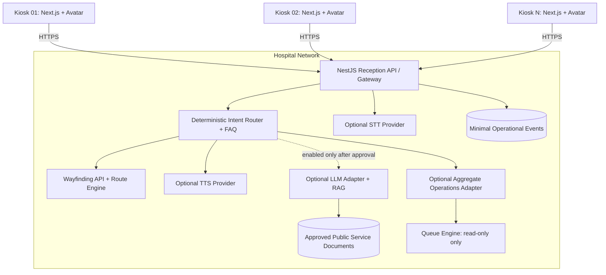

# Hospital Digital Reception AI — Implementation-Ready Design

Version 1.1 | 18 October 2026  
Status: Design specification; repository discovery and hospital approval are required before implementation.

## 1. Executive decision — LLM-optional architecture

Build a Thai voice-and-touch digital receptionist for Hospital Digital Twin. A realistic human-like avatar appears on multiple kiosk screens. Visitors can tap guided actions or speak. The project must deliver useful functionality **before any LLM is deployed**.

### Core decision

**The first release is a deterministic Smart Kiosk, not an LLM-dependent product.** Start with touch UI, approved FAQ, service directory, wayfinding, and pre-approved spoken responses. Add TTS and STT as separate capabilities. Evaluate an LLM only after measuring the questions that deterministic flows cannot answer.

- Central service architecture supports multiple kiosks, but a GPU/LLM server is not a prerequisite for Phase 1.
- Next.js 15 / React 19 / TypeScript renders kiosk UI and avatar.
- Three.js + React Three Fiber + Drei are avatar options if compatible with the existing repository.
- NestJS provides the Reception API, policy enforcement, session management, and provider adapters.
- FAQ, menu flows, destination lookup, route calculation, opening-hours lookup, and API calls use deterministic logic.
- TTS can speak approved or deterministic text without an LLM. STT can be added independently to map speech to known intents.
- Local LLM + RAG is an optional later capability behind an adapter, feature flag, and privacy gate.
- No patient-specific functions in the pilot: no HN, patient name, appointment lookup, check-in, diagnosis, treatment advice, or patient-specific queue status.
- Read-only integrations only. No AI component may mutate Queue Engine.
- Push-to-talk, visible microphone indicator, captions, stop button, and staff handoff are mandatory when voice is enabled.
- No camera or facial recognition in the pilot. Touch and static wayfinding must work when all AI/voice services are disabled.

This document is a proposed design. It does not assert that these modules or routes already exist in the repository. Inspect the repository before edits, migrations, dependency changes, or hardware procurement.

### Release strategy

- **Release A — No LLM:** avatar, touch menus, FAQ, deterministic wayfinding, approved prerecorded or TTS voice.
- **Release B — Voice intents:** local or otherwise hospital-approved STT maps speech to a bounded set of known intents; no open-ended LLM response required.
- **Release C — LLM evaluation:** benchmark an LLM against unresolved question categories using synthetic/non-patient test data. Do not procure AI hardware until the benchmark and cost model justify it.
- **Release D — Optional LLM/RAG:** enable only if it materially improves task completion and passes privacy, safety, quality, latency, and cost gates.


## 2. Scope

### Release A — Required first milestone (no LLM)
1. Realistic avatar with idle, greeting, pointing, and fallback states.
2. Touch menu, FAQ, service directory, and text search.
3. Deterministic wayfinding using the approved map and graph routing.
4. Pre-approved audio clips or TTS for known responses.
5. Clear staff handoff and accessibility fallback.
6. Minimal operational metrics without transcript storage.

### Release B — Voice without LLM dependency
1. Push-to-talk Thai STT.
2. Rule-based/intent-based mapping to a limited set of supported tasks.
3. TTS response and avatar lip animation where supported.
4. If intent confidence is low, ask the user to choose a menu or contact staff.

### Optional Release C/D — LLM and RAG
- Local LLM + RAG over approved service documents only.
- Use only if baseline metrics show a meaningful gap that deterministic flows cannot reasonably solve.
- Optional aggregate queue summary only after explicit approval and small-group suppression.

### Explicitly out of scope
- Clinical diagnosis, triage, medication, or treatment recommendations.
- HN, national ID, phone number, patient name, medical history, patient-specific appointment or queue lookup.
- Camera, face recognition, emotion detection, or biometric identification.
- Automatic check-in, booking, payment, or Queue Engine mutation.
- Arbitrary tool execution, SQL, shell, URL fetching, or uncontrolled HTTP forwarding.
- Silent cloud AI fallback or model training on conversations.

Any later patient-specific feature needs a separate approved threat model, identity design, privacy review, and scope decision.


## 3. Architecture — deterministic core, optional AI



### Runtime behavior
- The kiosk must be fully usable with `RECEPTION_AI_ENABLED=false` and `RECEPTION_VOICE_ENABLED=false`.
- Touch FAQ and wayfinding use deterministic backend logic; they must not call an LLM.
- Voice is an independent adapter: STT maps audio to a bounded intent set, and TTS reads approved/deterministic text.
- The optional LLM adapter is invoked only for eligible, non-sensitive questions that cannot be answered by deterministic flows and only when the feature flag and privacy policy allow it.
- If an LLM is absent, disabled, overloaded, or fails, fall back to menu/search/staff handoff.
- No external AI endpoint may be called implicitly. Provider configuration and outbound network policy must make any external provider explicit and approved.

### Trust boundaries
- A kiosk browser is public and physically accessible. Never embed secrets in frontend code.
- Only the Gateway may call internal voice/model runtimes and tools.
- Model ports are not exposed to kiosk VLAN or the public internet.
- Knowledge retrieval returns only documents approved for kiosk use.
- Model output is untrusted: never execute it as code, SQL, a URL, or an authorization decision.
- Queue access is limited to a small allowlist of read-only aggregate methods.


## 4. Recommended technology and rollout choices

| Layer | First implementation | Optional later | Selection notes |
|---|---|---|---|
| Kiosk UI | Next.js 15, React 19, TypeScript | — | Align with existing app after repo discovery |
| 3D avatar | Three.js, React Three Fiber, Drei | Avatar SDK if justified | Reuse existing rendering stack if present |
| Avatar asset | Licensed GLB/GLTF humanoid with rig | Higher-fidelity commercial avatar | Verify redistribution/commercial rights and kiosk performance |
| API | NestJS REST | WebSocket for streaming only if needed | Shared contracts/runtime validation if present |
| FAQ/navigation | Deterministic rules, approved content, graph routing | RAG for broader document queries | No LLM needed for the core journey |
| Voice input | Optional STT adapter | Local STT or approved provider | Benchmark Thai, accents, noise, license, and privacy |
| Voice output | Prerecorded audio or optional TTS adapter | Local TTS or approved provider | TTS does not require LLM |
| LLM | None in Release A | Local runtime such as llama.cpp/Ollama, or explicitly approved provider | Decide only after evaluation and cost analysis |
| Retrieval | Search/index only if needed | Local embeddings + vector index | Do not add vector DB for a small FAQ unnecessarily |
| Deployment | Existing app infrastructure | Separate inference host if needed | Do not buy GPU hardware before benchmark |
| Monitoring | Existing stack or Prometheus-compatible metrics | Model-specific metrics when LLM enabled | Never use user text/IDs as metric labels |

All candidates must be checked for current versions, licenses, Thai-language quality, and target-hardware compatibility before selection. Avoid adding infrastructure solely because it appears in a reference architecture.


## 5. Kiosk UX and states

Main actions:
- ค้นหาจุดบริการ
- ขั้นตอนรับบริการ
- เวลาทำการ
- ข้อมูลคิวทั่วไป (disabled until approved)
- พูดคุยกับผู้ช่วย
- เรียกเจ้าหน้าที่

Always show captions while speaking, visible microphone state, stop-listening control, large touch targets, and an accessible alternative to voice.

State machine:

```text
IDLE -> WELCOME -> MENU or CONSENT_TO_LISTEN
MENU -> LISTENING -> TRANSCRIBING -> UNDERSTANDING
     -> RETRIEVING / ALLOWED_TOOL -> RESPONDING -> SPEAKING -> IDLE

Any state -> HANDOFF | ERROR_RECOVERY | SESSION_RESET
```

Rules:
- No continuous recording by default. Push-to-talk starts capture.
- Audio buffers stay in memory and are discarded after transcription.
- Do not persist raw audio or transcripts by default.
- Reset transient state after 5 minutes of inactivity.
- Never speak patient-specific details aloud.
- If WebGL fails, show a 2D fallback; essential menus remain usable.

Avatar states:
- Idle: subtle blink/breathing.
- Listening: attentive pose + active microphone indicator.
- Processing: restrained animation + “กำลังค้นหาข้อมูล”.
- Speaking: visemes if supported, otherwise simple fallback mouth motion.
- Pointing: highlights a destination or menu.
- Uncertain/error: neutral animation and staff handoff.

Use a small number of polished states rather than many unreliable gestures.

## 6. Realistic avatar implementation

Asset requirements:
- GLB/GLTF with humanoid skeleton and facial blend shapes/visemes.
- Idle, greeting, listening, speaking, pointing, fallback animations.
- Optimized textures and materials for kiosk GPU.
- Explicit asset license for public/commercial use.
- No likeness of a real employee or patient without written authorization.

Suggested components (adapt after repo discovery; avoid duplication):
```text
apps/web/
  app/kiosk/page.tsx
  components/reception/
    ReceptionShell.tsx
    AvatarCanvas.tsx
    AvatarController.ts
    TouchMenu.tsx
    VoiceControls.tsx
    Captions.tsx
    ConversationStatus.tsx
    WayfindingPanel.tsx
    HandoffPanel.tsx
  lib/reception/
    kiosk-client.ts
    audio-capture.ts
    audio-playback.ts
    session-reset.ts
```

Keep avatar rendering client-side. Lazy-load the model, preload idle animation, load other animations on demand, and test long sessions for GPU memory leaks and thermal throttling. TTS viseme/phoneme timestamps are preferable; amplitude-driven lip motion is a less accurate fallback.

## 7. Voice pipeline — optional and independent of LLM

### STT
1. Visitor taps microphone and sees a clear listening state.
2. Browser requests microphone permission as needed.
3. Capture only during the active listening state.
4. Enforce duration and file-size limits.
5. Send audio to the Gateway over TLS.
6. Gateway validates session, MIME type, duration, body size, and rate.
7. Local STT returns text and optional confidence/language metadata.
8. Apply privacy/policy checks before LLM processing.
9. Discard audio after processing.

Starting limits to benchmark: 12 seconds per utterance, 8 MB upload, one active transcription per session. Tune after tests with real kiosk acoustics and synthetic/non-patient utterances.

### TTS
1. Gateway validates structured response and policy.
2. Local TTS synthesizes Thai audio.
3. UI shows the exact spoken text as captions.
4. Avatar animates using visemes where supported.
5. Audio is discarded after playback.

### Failure behavior
- STT down: touch menu and text input remain available.
- TTS down: display response text.
- LLM down: curated FAQ and static wayfinding remain available.
- Network down: approved static service directory can be cached with an owner and update process.
- User can cancel listening/processing where supported.

## 8. Optional Local LLM + RAG — only after evaluation

### Enablement gate
Do not implement or deploy an LLM in Release A. First collect aggregate counts of supported versus unsupported intent categories without retaining raw utterances. Create a synthetic evaluation set for the unresolved categories. Compare (a) adding deterministic intents/FAQ, (b) a local LLM, and (c) any explicitly approved alternative. Enable LLM only if it improves correct task completion enough to justify hardware, maintenance, latency, privacy, and operating costs. No procurement decision should be made from parameter count or demo quality alone.

LLM may:
- Classify intent, rewrite retrieval queries, summarize approved documents, explain verified routes, and generate grounded Thai responses.
- Return structured handoff reasons.

LLM may not:
- Invent locations, opening hours, policies, or queue estimates.
- Diagnose or recommend treatment.
- Infer patient identity or health status.
- Execute arbitrary SQL, shell commands, or URLs.
- Authorize a user or mutate records.

RAG pipeline:
1. Document owner approves source.
2. Extract text and metadata.
3. Remove secrets and non-approved content.
4. Chunk with headings and source references.
5. Create local embeddings.
6. Store chunks and version metadata.
7. Retrieve only approved, current kiosk sources.
8. Apply relevance threshold.
9. Generate answer grounded in sources.
10. Return citations.

Suggested metadata:
```ts
type KnowledgeDocument = {
  id: string;
  title: string;
  sourcePath: string;
  version: string;
  ownerDepartment: string;
  approvedForKiosk: boolean;
  effectiveFrom?: string;
  effectiveUntil?: string;
  contentHash: string;
};
```

Reject retrieval if not approved or outside the effective period. Ingestion must be explicit and auditable.

Prompt-injection defenses:
- Treat user input and retrieved documents as untrusted data.
- Never obey document instructions that override system policy.
- Strictly validate tool schemas and allowlist tool names.
- Never expose prompts, environment variables, secrets, or internal hostnames.
- Never automatically open a model-generated URL.
- Include adversarial tests.

## 9. API contracts

These are proposed routes, not verified existing routes. Use the repo's versioning and shared runtime validators after discovery.

### Kiosk session
- `POST /api/reception/v1/kiosk/session`
- `POST /api/reception/v1/kiosk/session/refresh`
- Admin-only revocation/device management route.

Provision each kiosk with a rotatable device credential. Exchange it for a short-lived signed session. Do not ship a shared static secret in the frontend. Kiosk identity identifies the device, not the patient.

### Start session
`POST /api/reception/v1/sessions`

Request:
```json
{"kioskId":"KIOSK-LOBBY-01","locale":"th-TH","channel":"touch"}
```

Response:
```json
{
  "sessionId":"opaque-random-id",
  "expiresInSeconds":300,
  "capabilities":{"voice":true,"wayfinding":true,"generalQueueInfo":false}
}
```

### Text turn
`POST /api/reception/v1/sessions/:sessionId/turns`

Request:
```json
{"input":{"type":"text","text":"ห้องยาอยู่ตรงไหน"},"uiContext":{"currentScreen":"home"}}
```

Response:
```json
{
  "turnId":"opaque-turn-id",
  "status":"completed",
  "response":{
    "text":"ห้องยาอยู่ชั้น 1 ตามแผนที่จุดบริการ",
    "intent":"wayfinding",
    "actions":[{"type":"show_wayfinding","destinationId":"PHARMACY"}],
    "sources":[{"id":"public-service-map-v3","title":"แผนที่จุดบริการ"}],
    "handoff":{"required":false,"reason":null}
  }
}
```

Use a strict discriminated union for `actions`; reject unknown actions. Resolve destination IDs on the server. Never accept arbitrary URLs from the model.

### Voice turn
`POST /api/reception/v1/sessions/:sessionId/voice-turns`
- `multipart/form-data`, field `audio`, optional `locale=th-TH`.
- Enforce size, duration, MIME, rate, concurrency, and session limits.
- Never log raw audio.
- Return the same response envelope as text turns.
- Start with synchronous requests; add versioned streaming only after measuring latency.

### Wayfinding
`GET /api/reception/v1/wayfinding/destinations?q=pharmacy`

Example:
```json
{"items":[{"id":"PHARMACY","displayName":"ห้องยา","buildingId":"MAIN","floorId":"F1","mapNodeId":"node-pharmacy","publicDescription":"จุดรับยา","isAvailable":true}]}
```

`POST /api/reception/v1/wayfinding/route`

Request:
```json
{"originNodeId":"node-kiosk-lobby","destinationId":"PHARMACY","preferences":{"avoidStairs":true}}
```

Response:
```json
{"destinationId":"PHARMACY","steps":[{"instruction":"เดินตรงไปตามโถงหลัก","mapNodeId":"node-main-hall"},{"instruction":"เลี้ยวซ้ายไปยังห้องยา","mapNodeId":"node-pharmacy"}],"mapVersion":"hospital-map-v4"}
```

Route calculation is deterministic graph logic, not LLM reasoning. Accessibility attributes must match verified map data.

### Optional aggregate operations endpoint
`GET /api/reception/v1/operations/summary`

Expose only approved aggregate metrics. No patient IDs, ticket IDs, names, individual timestamps, or small-group details. Keep disabled until hospital approves data definitions and minimum cohort size.

### Health
- `GET /health/live`
- `GET /health/ready`
- `GET /api/reception/v1/capabilities`

Error envelope:
```json
{"error":{"code":"AI_SERVICE_UNAVAILABLE","message":"ขณะนี้ระบบสนทนาไม่พร้อมใช้งาน กรุณาเลือกเมนูบนหน้าจอ","retryable":true,"requestId":"opaque-request-id"}}
```

Never return stack traces, prompts, filesystem paths, model internals, or secrets.

## 10. NestJS module layout

Adapt after inspecting existing code:
```text
apps/api/src/reception/
  reception.module.ts
  controllers/
    kiosk-session.controller.ts
    conversation.controller.ts
    voice-turn.controller.ts
    wayfinding.controller.ts
    operations.controller.ts
  services/
    kiosk-auth.service.ts
    session.service.ts
    conversation-orchestrator.service.ts
    intent-router.service.ts
    response-policy.service.ts
    handoff.service.ts
  adapters/
    stt.adapter.ts
    llm.adapter.ts
    tts.adapter.ts
    knowledge-retrieval.adapter.ts
    wayfinding.adapter.ts
    queue-readonly.adapter.ts
  guards/
    kiosk-session.guard.ts
    rate-limit.guard.ts
  dto/
  policies/
```

Orchestrator:
1. Validate kiosk identity/session.
2. Validate schema, quotas, and rate limits.
3. Normalize input and apply privacy filters.
4. Route simple intents by rules first.
5. Retrieve approved knowledge.
6. Generate grounded structured answer.
7. Validate schema and response policy.
8. Return text, sources, allowed actions, and handoff state.
9. Emit minimal usage metrics without transcript/audio.

Allowed tools initially:
- `searchApprovedKnowledge(query)`
- `findPublicDestination(query)`
- `calculateWayfindingRoute(originNodeId, destinationId, preferences)`
- `getApprovedAggregateQueueSummary(serviceId, timeBucket)` (disabled until approved)
- `requestHumanAssistance(reasonCode)`

Never expose generic `executeSql`, `runShell`, `fetchUrl`, or arbitrary API forwarding.

## 11. Data retention

Do not create permanent conversation history for the pilot.

Minimal session:
```ts
type ReceptionSession = {
  id: string;
  kioskId: string;
  locale: string;
  createdAt: string;
  expiresAt: string;
  status: "active" | "expired" | "closed";
};
```

Minimal usage event:
```ts
type ReceptionUsageEvent = {
  eventId: string;
  kioskId: string;
  sessionIdHash: string;
  eventType: "session_started" | "turn_completed" | "handoff_requested" | "service_unavailable" | "feedback_submitted";
  intentCategory?: string;
  durationMs?: number;
  success?: boolean;
  createdAt: string;
};
```

Defaults:
- Audio: memory only; discard after transcription.
- Raw transcript: not persisted.
- Session: expire after 5 minutes idle.
- Metrics: aggregate only for approved period.
- Audit: hospital-approved retention schedule.
- Redact request bodies, query strings, authorization headers, audio payloads, and model prompts from logs.

Hospital privacy/security owners must approve actual retention and notice wording.

## 12. Privacy, security, safety

- No camera in pilot.
- Push-to-talk with visible state and stop control.
- No patient identity or clinical record access.
- No raw audio/transcript persistence by default.
- Approved service knowledge only.
- Suppress small groups in any aggregate metrics.
- TLS, network segmentation, kiosk credentials rotation/revocation, rate limits, CSP, body/MIME validation, encrypted persistent volumes, and restricted admin RBAC.
- Only Gateway can reach model/STT/TTS ports.
- No external AI endpoint; audit outbound traffic.
- Keep model artifacts pinned and verified.
- AI must not diagnose or recommend treatment. For medical questions, state that the kiosk provides service navigation only and refer to authorized staff.
- For emergencies, show only hospital-approved emergency instructions; do not let the LLM invent guidance.
- If sources are weak or conflict, do not guess; hand off to staff.
- No emotion detection or inferred distress from appearance.

## 13. Deployment topology — no inference host required initially

```text
Kiosk VLAN:
  Next.js kiosk client; no model ports exposed

Application VLAN:
  reverse proxy; NestJS AI Gateway; knowledge/map APIs; metrics/audit

AI VLAN:
  local LLM; local STT; local TTS; embedding/index worker; approved knowledge index
```

Release A does not require an inference host: run the existing web/API stack and deterministic FAQ/navigation. Add STT/TTS services only when voice is enabled. A dedicated inference host is a later option if an LLM benchmark passes and hospital policy approves it. Keep logical access controls and resource limits; separate hosts or VLANs based on security requirements.

Illustrative Compose topology (not directly deployable until image references and host support are verified):
```yaml
services:
  reception-api:
    image: hospital/reception-api:PINNED_VERSION
    restart: unless-stopped
    environment:
      NODE_ENV: production
      AI_BASE_URL: http://llm-runtime:8080
      STT_BASE_URL: http://stt-runtime:8081
      TTS_BASE_URL: http://tts-runtime:8082
    ports:
      - "127.0.0.1:3000:3000"
    read_only: true
    security_opt:
      - no-new-privileges:true

  llm-runtime:
    image: PINNED_LOCAL_LLM_RUNTIME_IMAGE
    expose: ["8080"]

  stt-runtime:
    image: PINNED_LOCAL_STT_RUNTIME_IMAGE
    expose: ["8081"]

  tts-runtime:
    image: PINNED_LOCAL_TTS_RUNTIME_IMAGE
    expose: ["8082"]
```

Replace placeholders with vetted, pinned artifacts; add health checks, resource limits, secrets, volumes, and network definitions. Never expose model runtime ports publicly. Provide a kill switch to disable voice/LLM while touch menus continue.

## 14. Hardware sizing — defer AI procurement

### Release A (no LLM)
Size the kiosk and application server for the web app, API, map, and 3D avatar. Benchmark WebGL performance on the actual kiosk device. No GPU server is required solely to render the avatar: the kiosk renders the 3D model locally, subject to its graphics capability.

### Release B (voice)
Benchmark STT and TTS separately. Depending on the selected engines, they may run on CPU or a shared server; do not assume they require a large GPU. Measure concurrent voice sessions, memory, response latency, and Thai accuracy before choosing hardware.

### Optional LLM tiers — planning only, not procurement guidance
| Tier | Workload | Planning guidance |
|---|---|---|
| Evaluation | Synthetic benchmark, one test client | Use an existing suitable workstation/server if possible; compare CPU-only and available accelerator performance |
| Pilot | 1 kiosk, low concurrency | Benchmark the exact quantized model, context, STT/TTS mix, and target latency |
| Small rollout | Several kiosks with concurrent turns | Load test peak concurrency and headroom; only then estimate VRAM and worker count |
| Larger rollout | Multiple sites or many kiosks | Separate workloads or scale workers only when measurements show contention |

Do not infer a fixed kiosk capacity from GPU VRAM. Actual capacity depends on model, quantization, context length, concurrent sequences, STT/TTS, and latency target.

Memory considerations if LLM is approved:
- Model weights are roughly `parameter_count × bytes_per_parameter`, plus runtime overhead.
- Quantization lowers memory but may reduce quality.
- KV cache grows with context and concurrent sequences.
- STT/TTS need separate headroom.
- Reserve resources for OS, API, retrieval, and spikes.

Benchmark cold/warm startup, Thai STT accuracy in lobby noise, time-to-first-token, TTS pronunciation, concurrent turns, RAM/VRAM, thermal behavior over 4–8 hours, restart recovery, and end-of-speech-to-first-audio. Agree on latency targets after testing. Do not procure AI hardware until results and total cost are reviewed.


## 15. Monitoring and cost

Metrics without personal data:
- sessions and turns by kiosk group/channel
- duration and latency for STT, LLM, and TTS
- handoff counts by reason
- retrieval no-answer counts
- model errors and active requests
- inference memory and host temperature

Never use user text, session IDs, names, HN, or arbitrary input as metric labels.

Measure full cost: hardware, electricity, maintenance, model updates, knowledge curation, staff time, and cost per successful interaction. Compare against baseline staff time and repeat questions. Conversation count alone does not prove savings.

## 16. Test plan

### Unit tests
- Intent routing, tool allowlist, schema validation, source expiry, redaction.
- Session expiry, kiosk revocation, rate limits, body-size limits.
- Wayfinding graph, accessibility routes, unknown UI actions.
- Model outage and fallback behavior.

### Integration tests
- Gateway ↔ STT/LLM/TTS.
- Approved versus unapproved RAG sources.
- Session lifecycle, authentication, revocation.
- Wayfinding and map versioning.
- Optional aggregate queue adapter.
- Restart a model service during a conversation.

### Privacy/security
- Prompt injection in user input and retrieved documents.
- Requests for patient name/HN/diagnosis/appointment.
- Requests for secrets, prompts, internal URLs, other sessions, arbitrary tool execution.
- Verify audio/transcript absent from logs and persistent storage.
- Verify kiosk VLAN cannot reach model ports.
- Verify no outbound AI calls.
- Verify inactivity reset clears prior interaction.

### Thai evaluation set
Use synthetic, hospital-approved questions for colloquial Thai, regional accents, background noise, similar department names, incomplete questions, mixed English/Thai, unsupported clinical questions, and adversarial prompts. Score STT, retrieval precision, grounded correctness, hallucination rate, handoff correctness, latency, and comprehension. Do not use real patient conversations.

## 17. Pilot gates

### Stage 0 — Discovery and approvals
Inspect current repository, API, contracts, 3D scene, map model, auth, deployment, monitoring, kiosk hardware, network, approved documents, privacy notice, emergency wording, and licenses. Exit only with no unresolved high-risk data flow.

### Stage 1 — Offline prototype
One dev kiosk, touch FAQ, wayfinding, local RAG/LLM, STT/TTS, no patient data or live queue integration.

### Stage 2 — One physical kiosk
Low-risk public area, approved information only, visible staff help path, no check-in or patient lookup.

Proposed gates (not measured results; adjust after baseline):
- ≥95% correctness on in-scope FAQ evaluation set.
- Zero critical fabricated service instructions in release tests.
- 100% safe refusal/handoff for unsupported clinical/patient-specific prompts.
- 100% of tests confirm raw audio/transcripts are not persistently logged.
- ≥95% correct destination in common wayfinding tests.
- ≥95% availability during scheduled pilot hours excluding planned maintenance.
- P95 voice latency meets a target agreed after hardware benchmarking.
- AI can be disabled while touch navigation remains functional.

### Stage 3 — Multi-kiosk expansion
Test expected peak concurrency plus headroom, kiosk credential revocation, model overload, network outage, service restart, rollback, and operating cost. Expand only after gates pass and hospital owners approve.

Success metrics: self-service resolution, handoff rate, incorrect answer rate, interaction duration, user comprehension, staff time actually saved, cost per successful interaction, uptime, and abandonment.

## 18. Implementation order — staged, LLM-optional

1. **Repository discovery:** inspect current app, API, contracts, map, auth, deployment, and test commands. No edits before discovery.
2. **Contracts and feature flags:** add/reuse shared schemas and set `RECEPTION_AI_ENABLED=false`, `RECEPTION_VOICE_ENABLED=false`, `RECEPTION_QUEUE_SUMMARY_ENABLED=false` by default.
3. **Touch-only Smart Kiosk:** avatar shell, deterministic menus, FAQ, service directory, text search, staff handoff.
4. **Deterministic wayfinding:** approved map data and graph routing; no LLM for route calculation.
5. **Voice output:** prerecorded audio or TTS for approved responses; add captions and avatar state changes.
6. **Voice input:** STT adapter and bounded intent mapping; when uncertain, ask the user to select a menu or contact staff.
7. **Kiosk identity and deployment:** device provisioning, rotation/revocation, network controls, and rate limits.
8. **Observability and privacy checks:** aggregate metrics, redaction tests, and no transcript persistence by default.
9. **Baseline pilot:** measure FAQ resolution, wayfinding success, handoff, latency, and staff effort before AI.
10. **LLM need assessment:** aggregate unsupported-intent categories; write a synthetic evaluation set; compare deterministic additions with LLM options.
11. **Optional LLM adapter + RAG:** implement only if the business case and privacy/security review pass. Keep behind a feature flag and preserve no-LLM fallback.
12. **Load and failure tests:** test peak concurrency, provider outage, network outage, rollback, and cost.
13. **Expansion decision:** approve only after quality, privacy, operational support, and cost targets pass.


## 19. Decisions required before production

1. Map source and owner.
2. Approved documents and refresh cadence.
3. Kiosk screen, browser, microphone, speaker, GPU, and network.
4. Number of kiosks and peak concurrent voice sessions.
5. Selected local STT/TTS/LLM and licenses.
6. Whether aggregate queue information is allowed and minimum cohort size/time bucket.
7. Human handoff destination and availability.
8. Hospital-approved emergency wording.
9. Privacy notice, retention, audit, and incident process.
10. Device credential provisioning and rotation.
11. Latency and availability targets.
12. Budget cap and cost-per-successful-interaction target.
13. Evidence that deterministic FAQ/intent routing is insufficient before approving LLM work.
14. Written approval for any external AI provider or outbound data flow.

Keep unresolved features disabled rather than inventing policy.

## 20. Claude Code repository discovery prompt

> Read this document completely. Inspect the repository and report the actual structure, current Next.js kiosk/3D implementation, NestJS modules, shared contracts, authentication, map representation, Queue Engine interfaces, test commands, Docker/deployment configuration, and monitoring. Do not assume any route, schema, package, or feature exists unless verified in code.
>
> Treat this specification as **LLM-optional**. Identify the smallest implementation path for Release A that uses deterministic FAQ, touch UI, avatar, and wayfinding without any LLM, vector database, GPU server, or external AI call. Then identify separate optional tasks for TTS, STT, and a future LLM evaluation. Do not recommend buying AI hardware before an evidence-based benchmark.
>
> Create only `docs/HOSPITAL-DIGITAL-RECEPTION-AI-DISCOVERY.md` containing: (1) verified architecture with file paths, (2) reusable components/APIs, (3) gaps versus this specification, (4) privacy/security concerns, (5) minimal Release A plan with exact files, (6) optional voice/LLM dependencies and unresolved license/hardware questions, and (7) tests run with actual results.
>
> Do not modify application code, dependencies, migrations, environment files, or deployment configuration. Do not claim tests passed unless run. Do not send data to external AI services. Stop after the discovery report for human review.


## 21. Definition of Done

### Release A — no LLM
- Touch menu, FAQ, service directory, and deterministic wayfinding work on the target kiosk.
- Avatar has idle, greeting, pointing, and fallback states.
- Approved responses can be displayed and optionally spoken through prerecorded audio/TTS.
- No patient identity or clinical data is required.
- AI/voice can be disabled without breaking touch navigation.
- Kiosk credentials, API access, and admin controls are protected.
- Unknown questions lead to clarification, search, or approved staff handoff—not fabricated answers.
- Privacy, accessibility, usability, and failure tests pass.

### Release B — voice
- Thai push-to-talk works on selected hardware.
- Listening state is visible; users can stop/cancel.
- Raw audio/transcripts are not persisted by default.
- Voice intent mapping is bounded and uncertain requests fall back safely.
- STT/TTS quality, latency, concurrency, and license are documented.

### Optional LLM release — only if approved
- Evidence shows deterministic functionality is insufficient for a meaningful set of queries.
- A synthetic evaluation set demonstrates improved correct task completion.
- Grounded responses use approved sources and citations where appropriate.
- AI cannot call arbitrary tools or mutate Queue Engine.
- Prompt injection, privacy, Thai-language, concurrency, outage, and cost tests pass.
- Hardware and operating cost are measured and accepted; no external AI endpoint is called without explicit approval.

**Final recommendation:** Start with one kiosk, one approved service-information collection, deterministic FAQ, and read-only wayfinding. Add voice independently. Treat Local LLM as an optional optimization that must earn its place through benchmark evidence—not as a prerequisite for the project.
